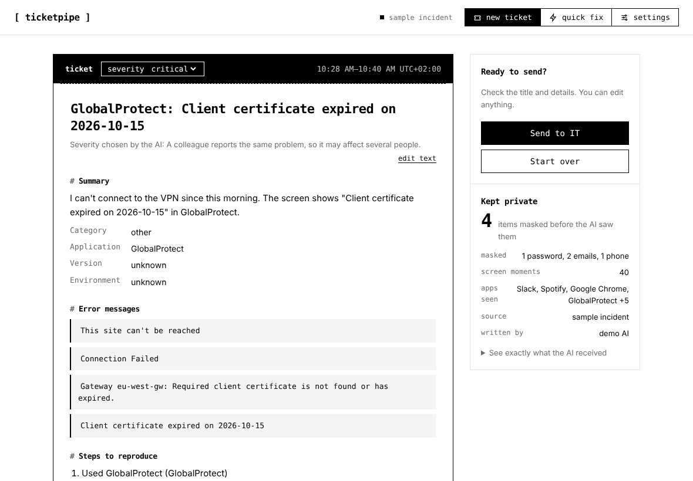
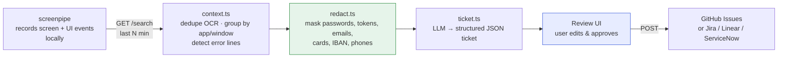
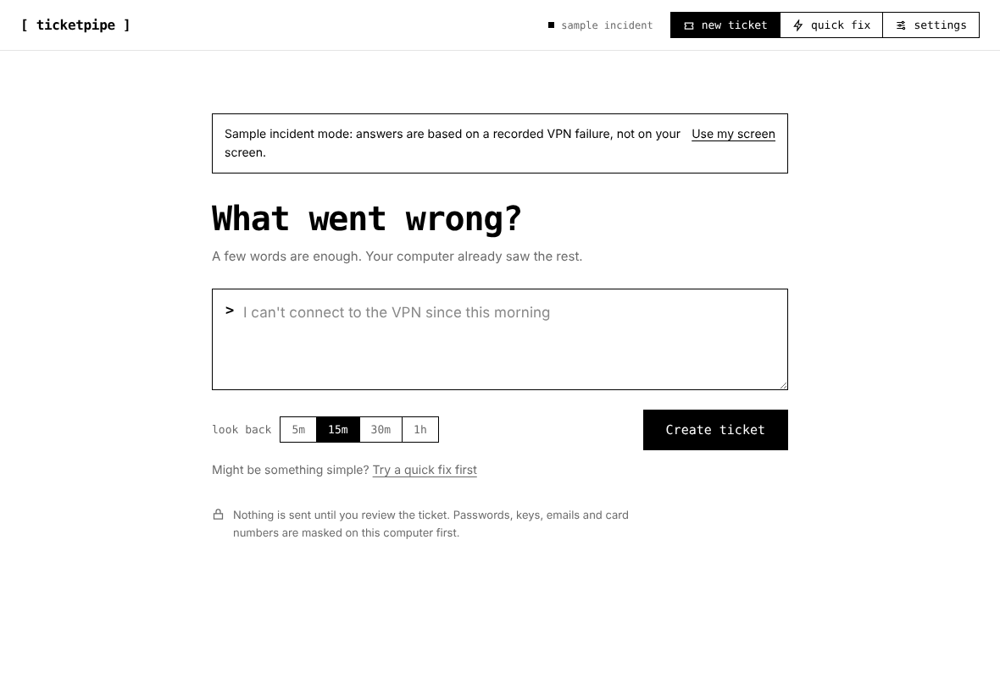
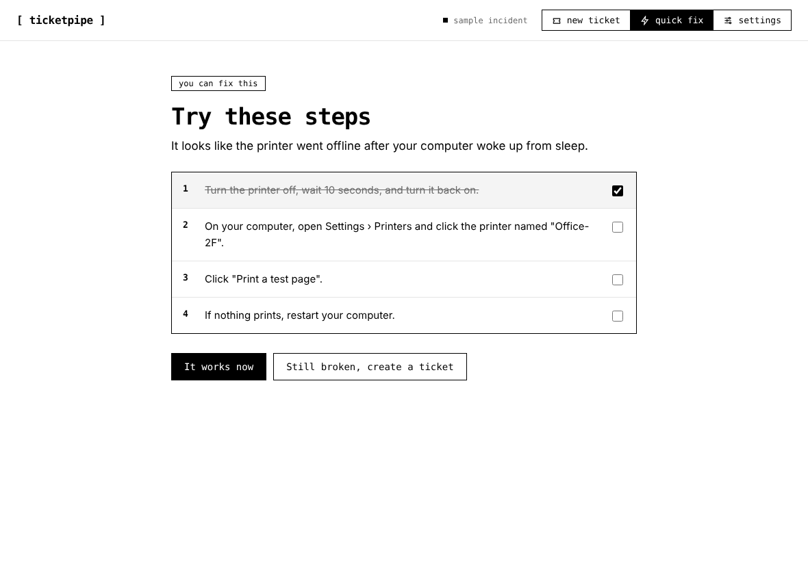

# [ ticketpipe ]

**TicketPipe turns what your computer already saw into a precise IT ticket, or fixes simple problems on the spot.** Built on [screenpipe](https://screenpipe.com).

> _"VPN doesn't work, thanks"_ → IT replies _"Which error? Which version? Can you send a screenshot?"_ → the user has to reproduce the bug… which may not happen again.

With screenpipe, the bug **has already been recorded**. One click and TicketPipe reads the last minutes of screen activity, keeps what matters, masks secrets locally, and writes the ticket an IT technician actually wants: exact error messages, steps, app version, OS, what the user already tried, and a timeline.

Track: **Make it work for a team** (and a bit of _find what to automate_: every vague ticket is a support loop we remove).

<!-- TODO: replace with your demo GIF / video link -->


---

## Before / after

| What IT gets today | What IT gets with TicketPipe |
|---|---|
| **Subject:** VPN marche pas<br>"le VPN ne marche plus depuis ce matin, je ne peux pas accéder à l'intranet. Merci" | **GlobalProtect: client certificate expired — cannot connect to eu-west-gw**<br>• Error (verbatim): `Required client certificate is not found or has expired.` / `Client certificate expired on 2026-10-15`<br>• GlobalProtect 6.2.1-87 · macOS Sequoia 15.4.1 · MacBook Pro M3 Pro<br>• Already tried: retry ×2, quit & relaunch the app; gateway reachable (ping OK, 0% loss)<br>• Suggested: renew/re-issue the user's client certificate |

_(Fictional example — try it yourself with `bun run demo`.)_

## Two buttons, two jobs

- **new ticket**: describe the problem in a few words; TicketPipe writes the ticket from what screenpipe saw: exact errors, steps, timeline (local time), a severity chosen by the AI with its reason, up to 3 possible solutions in plain language, and at most 3 questions IT may still ask.
- **quick fix**: for everyday problems (printer, Wi-Fi, an app that froze…), TicketPipe suggests up to 5 simple steps the user can do alone. If it's not something a user should fix (expired certificate, locked account, admin rights…) it says so. If the steps don't work, one click turns it into a ticket that already lists what was tried.

**Let TicketPipe try** can attempt a suggested fix in one application window you select, using the existing AI and Screenpipe context. Windows is the tested baseline. Native controllers are now implemented for macOS 13+ and GNOME Linux desktops, including Ubuntu Desktop and Fedora Workstation; their desktop acceptance is pending. Wayland uses accessibility operations and asks you to bring the selected window forward. Progress and Stop remain available, and success is checked independently. See [platform support, setup and verified coverage](docs/automatic-fixes.md) and the [native test checklist](docs/native-testing.md).

## How it works



1. **Collect** — calls screenpipe's local REST API (`/search`) for OCR text and UI events over the last _N_ minutes.
2. **Clean** — OCR repeats the same text every frame: we dedupe lines per app/window, build a chronological timeline of "app sessions", flag lines that look like errors (EN + FR), and fit everything into a token budget (most recent first).
3. **Redact** — secrets and personal data are masked **on the machine, before any LLM call**: passwords, API keys, JWT/Bearer tokens, private keys, emails, phone numbers, IBANs, card numbers (Luhn-checked).
4. **Generate** — the LLM gets a strict prompt: only facts present in the context, error messages copied verbatim, unknowns listed as "missing info" instead of invented.
5. **Review** — the user sees the ticket **and exactly what was sent to the AI**, edits it, and decides to send. Nothing is published without that click.
6. **Publish** — creates a GitHub issue with labels (`it-ticket`, `severity:*`). No GitHub set up? It is saved as a Markdown file in `Documents/IT tickets`.

## Install

Download the file for your computer from the [Releases](../../releases) page, then:

| System | File | First launch |
|---|---|---|
| **Windows** | `ticketpipe-windows-x64.exe` | Double-click. If SmartScreen warns you: *More info › Run anyway* (the app isn't code-signed yet). |
| **macOS** (Apple silicon / Intel) | `ticketpipe-mac-arm64.zip` / `ticketpipe-mac-x64.zip` | Unzip, move **TicketPipe** to Applications, then right-click › *Open* the first time (unsigned app). |
| **Linux** | `ticketpipe-linux-x64` / `-arm64` | `chmod +x ticketpipe-linux-x64 && ./ticketpipe-linux-x64`. Run once with `--install` to add it to your applications menu. |

The app opens in its own window (it uses Chrome, Edge, Brave or Chromium if installed, otherwise your default browser). Close the window to quit.

On first launch, a 3-step setup asks for the following. It only happens once: everything is saved on the computer.

1. **Your screenpipe API key**: TicketPipe finds it automatically when screenpipe is installed (it runs `screenpipe auth token` for you). Otherwise: screenpipe app › *Settings › Privacy*.
2. **An AI**: Google Gemini or Groq (free tiers), Claude, OpenAI, a local Ollama model, or a demo AI that needs no account.
3. **Where tickets go**: a folder on your computer (`Documents/IT tickets`), or GitHub issues (repository + fine-grained token with *Issues: Read and write*).

Each step has a **Test** button that says exactly what's wrong if something doesn't connect. Everything can be changed later in **Settings**. Settings are stored only on your computer (`~/.config/ticketpipe`, `~/Library/Application Support/TicketPipe` or `%APPDATA%\TicketPipe`).

**Just want to see it?** Click *Try it with a sample incident* on the setup screen, or launch with `--demo`.





## Develop

Requirements: [Bun](https://bun.sh) ≥ 1.2.3.

```bash
git clone <this-repo> && cd ticketpipe
bun install
bun run app          # server + app window
bun run demo         # same, with the sample incident
bun run dev          # server only → http://127.0.0.1:4242
bun run build        # executables for Linux, macOS and Windows → dist/
```

Developers can also configure everything with a `.env` file (see `.env.example`); settings saved from the app take precedence.

### CLI (bind it to a global keyboard shortcut)

```bash
bun run ticket                                   # draft from the last 15 min
bun run ticket -m 5 -n "can't open the intranet" # 5 min + a note
bun run ticket --show-context                    # also print what is sent to the AI
bun run ticket --publish                         # draft + create the GitHub issue
bun run ticket --demo                            # on the sample incident
```

### Record a fixture (demo safety net)

```bash
bun run snapshot 10                              # save the last 10 min of screenpipe data
CONTEXT_FILE=fixtures/snapshot-<date>.json bun run dev
```

### Environment variables

| Variable | Default | |
|---|---|---|
| `SCREENPIPE_URL` | `http://localhost:3030` | screenpipe API |
| `SCREENPIPE_API_KEY` | – | `screenpipe auth token` |
| `CONTENT_TYPES` | `ocr,accessibility,input` | add `audio` to include transcripts |
| `LOOKBACK_MINUTES` | `15` | default window |
| `MAX_CONTEXT_CHARS` | `12000` | context budget sent to the AI |
| `CONTEXT_FILE` | – | replay a saved response instead of calling screenpipe |
| `LLM_PROVIDER` | `anthropic` | `anthropic` · `openai` (any OpenAI-compatible endpoint: Gemini, Groq, Mistral, Ollama…) · `mock` |
| `ANTHROPIC_API_KEY` / `ANTHROPIC_MODEL` | – / `claude-sonnet-5-5` | when `LLM_PROVIDER=anthropic` |
| `OPENAI_API_KEY` / `OPENAI_MODEL` / `OPENAI_BASE_URL` | – | when `LLM_PROVIDER=openai` |
| `TICKET_LANGUAGE` | `en` | e.g. `fr` |
| `GITHUB_TOKEN` / `GITHUB_REPO` | – | fine-grained token with *Issues: read & write* · `owner/repo`. Empty = saved to `Documents/IT tickets` |

## Privacy by design

- The server listens on **127.0.0.1 only**. Screen data never leaves the machine except the redacted context sent to the LLM, and the ticket the user explicitly approves.
- Redaction happens **before** the LLM call, and again on the generated ticket.
- The review screen shows **the exact text sent to the AI** — no black box.
- Pick **Local model (Ollama)** in Settings to keep everything on the computer, AI included.
- Settings and keys are stored in a file only the current user can read.

## Project structure

```
src/
  app.ts        desktop entry point: starts the server, opens the app window, quits when it closes
  config.ts     defaults ← .env ← settings saved by the app
  context.ts    screenpipe /search → deduped timeline + error highlights
  redact.ts     local masking of secrets & personal data
  ticket.ts     prompt, LLM providers (Anthropic / OpenAI-compatible / mock), JSON parsing, markdown
  publish.ts    GitHub Issues (+ dry-run). Add Jira / Linear / ServiceNow here
  pipeline.ts   fetch → clean → redact → LLM → markdown
  server.ts     local API (/api/settings, /api/test/*, /api/draft, /api/publish)
  open.ts       open links / folders with the system's default app
  cli.ts        terminal version
public/index.html   the whole interface (setup, report, review, settings)
scripts/build.ts    standalone executables for Linux, macOS, Windows
scripts/snapshot.ts save live screenpipe data as a fixture
fixtures/           demo data (fictional)
```

## Roadmap

- **Duplicate detection** — before creating a ticket, search open issues for the same error ("12 users hit this certificate error today" → one incident instead of 12 tickets).
- **Self-service fix first** — match the error against a knowledge base and suggest the fix before escalating.
- **IT dashboard** — aggregate tickets by app/error to spot failing tools across the team.
- **Connectors** — Jira Service Management, ServiceNow, Linear, Zendesk.
- **Native trigger** — package as a screenpipe pipe + global hotkey / menu-bar button.
- **Screenshot attachment** — attach the redacted frame of the error (screenpipe frames API).
- **Smarter windowing** — auto-detect when the problem started instead of a fixed look-back.

## Team

<!-- names / 42 logins -->

Built at the screenpipe hackathon, October 2026.
