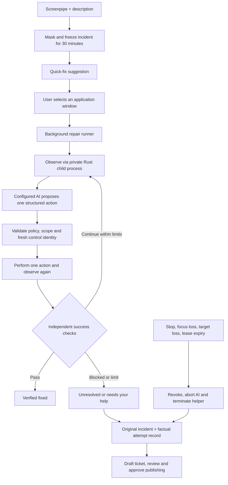

# Automatic quick fixes

Windows remains the verified baseline (`253544c`). Native controllers are implemented for macOS and GNOME Linux, including Ubuntu Desktop and Fedora Workstation. New platform desktop acceptance remains unverified until the native tests below are completed.

| Platform | Planned support | Current verification |
|---|---|---|
| Windows x64 | Windows UI Automation | Existing real-AI baseline; shared protocol and regression tests pass |
| Ubuntu 24.04 x64 GNOME | Wayland and Xorg | Native helper builds/tests in Ubuntu WSL; GNOME desktop acceptance pending |
| Ubuntu 26.04 x64 GNOME | Wayland | Pending native desktop acceptance |
| Fedora Workstation x64 GNOME | Wayland; Xorg where the release provides it | Pending native desktop acceptance; record exact release |
| Linux ARM64 GNOME | Matching helper and executable | Helper/executable built; native runtime and desktop acceptance unverified |
| macOS 13+ Apple Silicon | Apple Accessibility | Apple-target source check passes; native build/acceptance pending |
| macOS 13+ Intel | Apple Accessibility | Apple-target source check passes; native build/acceptance pending |

Other desktop environments, WSLg, headless servers and container sessions are outside the qualified scope. A distro name alone does not establish usable accessibility or reliable focus tracking. Ubuntu 26.04's standard GNOME session is Wayland-only ([release notes](https://documentation.ubuntu.com/release-notes/26.04/summary-for-lts-users/)). Fedora Workstation uses GNOME ([Fedora](https://fedoraproject.org/workstation/)).

After generating a quick-fix suggestion, choose **Let TicketPipe try**, select an existing application window, and start. Keep the selected window in front. Switching applications stops the attempt. TicketPipe's Stop button remains available; closing the controlling page also stops execution. Routine actions run without individual approval.

The helper uses Windows UI Automation, Apple Accessibility or AT-SPI over D-Bus. Apps must expose accessible controls. Unreadable apps, administrator prompts, protected fields, destructive operations, terminals, and fixes requiring another unrelated window need user intervention. No screenshot or coordinate fallback is used. Manual quick fixes and tickets continue to work when automation is unavailable.

macOS Accessibility and the Linux desktop accessibility bridge are enabled only through the explicit setup button. Readiness checks never prompt. Refreshing readiness preserves an unexpired incident. Permission denial/revocation prevents execution; granting permission never starts or resumes a run. The repair feature requests no screenshots, screen recording or microphone access.

On GNOME Wayland (including XWayland applications), only semantic accessibility operations are available. No keyboard input is exposed. Bring the selected window forward when asked, within 15 seconds; Stop remains available and no controls are observed or acted on during this wait. It counts toward the three-minute limit. Xorg keys require unique PID/title correlation to the active X11 client. Mac shortcuts use an independent Command-key allowlist and process-targeted events. Both native helpers re-resolve controls, compare fresh state, consume observations once and reject unproven dialog ownership. Focus loss after handoff revokes the attempt without reacquisition.

The configured AI receives the original masked incident, suggestions, explicitly checked manual steps, and masked live accessibility information. Captured content is untrusted evidence. A planner establishes fixed success criteria and proposes the first action in the same request. The runner validates both before input, avoiding a second AI round trip before the first action. The runner independently checks accessible text, visibility, values, selection and toggle state; an AI completion message cannot establish success. For editable value checks, a unique automation ID and role can identify a field whose name changes after editing, provided the observation is complete. Other checks and ambiguous or truncated observations retain exact-name matching. Explicit user confirmation is labeled user-reported.

## Runtime

Limits: one active attempt; 20 input actions; three minutes overall; 45 seconds per AI request; 12 seconds without a UI heartbeat. The UI polls once per second and renews its lease every four seconds. Initial activation allows up to one second for Windows to finish the requested handoff and requires 75 ms of stable target focus before observation or input. That wait permits only the original foreground window (or a transient absence of foreground) until the target is reached. An unrelated window, cancellation, or focus leaving an already reached target stops startup. No focus is reacquired during this wait or an active attempt. The helper independently monitors scope every 100 ms, rechecks before input, resolves controls again, and consumes every observation once. UIA calls have a 12-second watchdog; Stop kills a stalled helper. Process identity includes handle, PID and process creation time. Owned dialogs must belong to the same process and selected root owner.

No attempt resumes after restart. Incident snapshots and run records are held in process memory. Active incidents are pinned against expiration. Ticket escalation uses those snapshots and a deterministic audit section. Unacknowledged input is labeled uncertain and excluded from the factual “Already tried” list.

The UI distinguishes reading controls, waiting for AI, acting and verification, and shows elapsed AI waiting time. Bounded diagnostic logs persist stage timings, counts, outcome and failure codes in the per-user TicketPipe `logs/automatic-fixes.jsonl` file (on Windows, `%APPDATA%\TicketPipe\logs\automatic-fixes.jsonl`). Rotation keeps the current file and one previous file, approximately 256 KB each. Logs exclude incident text, window titles, control names and values, prompts, model responses and credentials. They cannot restore a run or authorize actions. A failed log write does not interrupt Stop or repair execution.

## Local interfaces

Every control request needs the per-launch `x-ticketpipe-token` from the served UI, the exact loopback Host, and a matching Origin when present. Generated previews use DOMPurify and a restrictive content security policy.

| Interface | Purpose |
|---|---|
| `GET /api/fix/status` | Read-only protocol, platform, permission and setup readiness |
| `POST /api/fix/permissions` | Explicit accessibility setup; never starts a repair |
| `GET /api/fix/windows` | Enumerate eligible windows; return short-lived opaque choices |
| `POST /api/fix/runs` | Start with incidentId, windowId and manualSteps; return 202 immediately |
| `GET /api/fix/runs/:id` | Progress, audit, checks and outcome |
| `POST /api/fix/runs/:id/stop` | Revoke and cancel |
| `POST /api/fix/runs/:id/heartbeat` | Renew UI lease |
| `POST /api/fix/runs/:id/confirm` | Record explicit user confirmation |
| `POST /api/draft` | Accept incidentId, optional fixRunId and manualSteps |

## Development and packaging

Run `bun install`, `bun run build:native`, `bun run typecheck`, and `bun test`. Building the Windows controller requires Rust and a Windows linker. `scripts/build-native.ts` uses Cargo from PATH or the workspace's existing portable GNU toolchain. `bun run build windows-x64` embeds the release helper directly into the standalone executable. At runtime it extracts a hash-versioned, integrity-checked copy in the per-user TicketPipe native folder. The recipient needs no Rust, Python, Node or Bun installation. Run the executable with `--check-controller` for a read-only extraction and controller availability check.

The repair runner and controller are TicketPipe implementations. They do not import Workshop Companion's agent or application stack. Existing window-identity and cancellation patterns inform the design; the workspace's portable Rust build tools are reused.

Every release now requires a matching native helper. Linux embeds an integrity-checked executable and extracts it with owner-only permissions. Mac bundles contain the helper at `Contents/Helpers/ticketpipe-controller` and use stable bundle identifiers, minimum macOS 13, and ad-hoc signatures for private testing. Replacing a private Mac build may require granting Accessibility again. Recipients need no language runtime or compiler.

Build helpers on their native OS. Cross-packaging requires a matching prebuilt helper, checked for format and architecture; Mac signing finishes on a Mac. Missing helpers fail clearly before release outputs are changed. See [native build commands and the desktop acceptance checklist](native-testing.md).

`bun run scripts/native-acceptance.ts` serves disposable browser controls at `http://127.0.0.1:4243`. Bring that page to the foreground, then click Run acceptance checks. It exercises the real native boundary, field input, independent verification, destructive-action refusal, stale observations, protected fields, replaced identity, and Stop. These scripted checks are separate from production agent behavior. Real configured-AI acceptance must additionally exercise successful repair, unsuccessful repair and Stop with live Screenpipe evidence in ordinary applications.

## Cross-platform implementation checks on 2026-10-18

- Type checking and 38 Bun tests pass, covering the existing runner/ticket/publishing regression suite plus version/platform rejection, platform keys, manual handoff, late focus, cancellation, permission setup, helper retention and overlapping pickers. Publishing remains mocked; no ticket was posted.
- Nine Windows Rust tests and four Linux Rust tests pass. Eight native boundary checks pass in an existing Chrome installation on Windows using disposable controls, including semantic toggle/text input, independent verification, protected/destructive controls, consumed observations, Stop and invalid identities.
- Linux x64 helper builds natively in Ubuntu 24.04 WSL. The standalone Linux executable launches without developer tools on PATH, extracts its helper on a native Linux filesystem with owner-only `700` directory/executable modes, and correctly reports WSLg as outside the GNOME session scope. A Windows-mounted folder that ignores POSIX modes is refused. These checks do not qualify a GNOME graphical session.
- Both macOS architectures and Linux ARM64 pass source checks. The ARM64 Linux helper also builds on Ubuntu using Rust's self-contained musl target and is bundled into the ARM64 executable; that executable has not been run on ARM64 hardware. Mac helpers and signed bundles have not been built or run on macOS here. Ad-hoc signing and permission behavior remain unverified until the Mac build and desktop checklist are run.
- The packaged Windows executable reports a ready, compatible embedded helper with only Windows system folders on PATH. Mac builds fail clearly when matching prebuilt helpers are absent; stale controller-free release files are not rebuilt as new Mac releases.
- Ubuntu GNOME 24.04 Wayland/Xorg, Ubuntu 26.04 Wayland, Fedora Workstation GNOME, Linux ARM64 runtime, and Mac Intel/Apple Silicon native real-AI acceptance are pending. Use [the native test checklist](native-testing.md) and record each architecture/session separately. Current Windows boundary checks do not repeat the complete baseline real-AI picker-to-target suite described below.

## Windows baseline validation recorded on 2026-10-18

- Type checking passed; 30 Bun tests and seven Rust tests passed.
- Eight native boundary checks passed against disposable controls in an existing Chrome installation.
- Real Gemini 3.5 Flash Lite calls with live Screenpipe evidence exercised verified repair, a disabled control requiring user help, and Stop during an AI request. The desktop window picker and progress UI were also exercised; moving focus away stopped a run.
- Real AI ticket drafting retained the original evidence and included exactly one genuinely performed action. Local saving and GitHub publishing regression tests passed; GitHub publishing used a mocked response and no issue was posted.
- All five release targets compiled. Both macOS archives were checked for the executable permission on the bundled binary. macOS and Linux binaries were not launched on this Windows host.
- The final Windows executable ran a complete real AI repair with only Windows system directories on PATH. Its embedded helper extracted and operated successfully; no Rust, Python, Node or Bun executable was available through PATH. This was an isolation check on the development computer, not a clean-machine installation test.

Acceptance covers Chrome accessibility controls, not every Windows application. Production repair decisions come from the general agent prompts and structured action policy; the fixture procedures are not part of that runner.

### Follow-up: Chrome search-field test

Screenpipe frames 13856 and 13857 show the user's selected Chrome New Tab search field still containing `apples` between 07:54:50 and 07:56:12 Europe/Paris. Input records show a switch back to TicketPipe at 07:56:13, followed by the focus-loss outcome in frame 13859. No actions were listed. That run had no persistent diagnostic log, so the stage responsible for its initial delay cannot be established retrospectively.

After adding stage diagnostics and the combined planning/first-action request, a real Gemini 3.5 Flash Lite run in a disposable Chrome New Tab window replaced `apples` with `oranges` and independently verified the value in 4.6 seconds, with one AI request and one text action. An earlier replay returned an invalid success check and correctly performed no input. Regression coverage additionally verifies cancellation of a late combined response, validation before the first action, changing control names, ambiguous identities and log payload privacy. These findings do not prove the exact cause of the original delay.

### Follow-up: initial window handoff

The next user attempt, at 08:16:02 Europe/Paris, ended after 41 ms with `focus_lost` during `connecting`, before observation, AI inference or input. Screenpipe's focus event for the selected Chrome window was recorded at 08:16:02.132562, approximately 7 ms after the controller's failure. The native binding checked foreground focus immediately after requesting activation. Windows can complete cross-input-queue activation asynchronously ([Microsoft explanation](https://devblogs.microsoft.com/oldnewthing/20161118-00/?p=94745)).

The controller now waits for the bounded initial handoff described above. It also avoids the input-queue attachment fallback when SetForegroundWindow has already accepted the activation request. Regression tests cover delayed activation, deadline, an unrelated window, focus leaving the target during startup, failed binding without AI/input, and cancellation of a late binding response.

A complete real desktop test used the rebuilt Windows executable, live Screenpipe context, the quick-fix result, the actual application picker and a separate Chrome New Tab window. At 08:27:05, selecting that window completed binding in 159 ms, followed by one real Gemini request and one text input. `apples` became `oranges` without submitting a search; independent verification and the TicketPipe UI both reported `verified_fixed` after 2.396 seconds. A separate accessibility read confirmed the Chrome field value. This test exercised the window handoff rather than starting with the target already focused. All five release targets were rebuilt.

The user subsequently confirmed that the repair worked in their own manual test. This is the tested Windows baseline saved on `codex/screenpipe-testing`.
